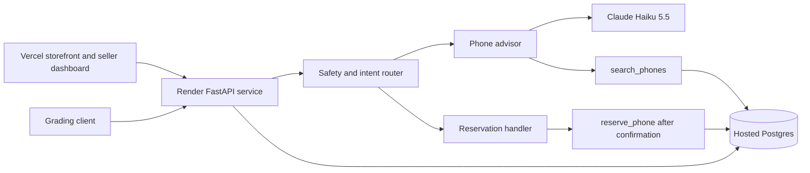

# G36 — ShopBot Mobile

Track 1: a mobile phone storefront for independent Islamabad sellers. Shoppers compare in-stock variants and reserve for pickup; sellers manage catalog, stock and holds in a protected dashboard. Proposed business model: PKR 1,500 per shop per month, with payment for the phone at pickup.

This is a single-store demo, not a live deployment. The sibling `Workshop/` clone is reference material only.

## Run locally

Use Python 3.12 and a disposable Postgres database. From the ShopBot directory:

```sh
python3 -m venv .venv
. .venv/bin/activate
pip install -r api/requirements.txt
cp .env.example .env
```

Fill in `.env` using a direct or session-mode Postgres URL and a strong, unique seller token. Provide the group API key only in backend secrets. Startup creates the schema, synthetic sample inventory, and checkpoint tables.

```sh
uvicorn main:app --app-dir api --port 7860
```

In a second terminal, run `python3 -m http.server 3000 --directory web` and visit `http://localhost:3000`. Open the seller dashboard and enter the seller token to update available stock or view pickup holds. The token is not persisted in browser storage. Run the cases in `tests.json` in order against fresh demo state.

See [deployment steps](DEPLOY.md) for hosted Postgres, Render's native Python backend, and the Vercel site. Keep all secrets on the API host.

## Local verification

Install `httpx` in the same virtual environment, then run `SHOPBOT_TEST_DATABASE_URL='your disposable Postgres URL' python api/smoke_test.py`. Use a fresh database: the test creates sample data, writes a demo reservation, and adjusts demo inventory. It stubs Claude and makes no billable requests.

| Check | Result |
| --- | --- |
| FastAPI contract, catalog filtering and database-backed pickup flow | Passed locally |
| Same-thread recall, cross-thread preferences and cross-user isolation | Passed locally |
| Confirmation, duplicate protection, tested refusal paths and seller authorization | Passed locally |
| Live Claude classification and hosted API | 10/10 project cases matched expected API behavior; see below |

### Hosted benchmark — 24 November 2026

| Case | Observed result | Latency | Input / output tokens |
| --- | --- | ---: | ---: |
| Catalog filters | A16 and Redmi Note 14 only | 4.629 s | 890 / 102 |
| Same-thread reference | Correct second phone preview; no reserve tool | 4.520 s | 875 / 55 |
| Cross-user confirmation | No pending hold | 3.121 s | 0 / 0 |
| Confirm hold | Reservation tool succeeded and returned pickup code | 3.594 s | 0 / 0 |
| Confirm again | Same code; no second reserve tool call | 3.115 s | 0 / 0 |
| Save preference | Acknowledged Xiaomi preference | 4.320 s | 884 / 93 |
| New thread, same user | Xiaomi ranked first | 4.779 s | 890 / 32 |
| New thread, different user | Default price ordering | 4.708 s | 878 / 32 |
| Bypass attempt | Refused; no reserve tool call | 3.033 s | 0 / 0 |
| Off-topic request | Refused; no inventory tool call | 4.238 s | 890 / 34 |

**Total:** 5,307 input and 348 output tokens across six model-backed turns; zero transport or response-contract errors. These are reported tokens, not billed dollars. Results are from our own ten cases, not the instructor's hidden benchmark. The live run checked replies and reported calls; stock mutation assertions were tested separately in the local Postgres smoke test.

Two follow-up health checks returned HTTP 200 with plain `ok` in 0.45 s and 0.43 s. They followed less than 20 minutes of idle time and are not cold-start measurements. To measure cold start, stop traffic to the Render API for at least 20 minutes, then time the first and immediately following health requests. Compare the first response to the grader's timeout and retry policy.

After deployment, run `python api/benchmark.py https://YOUR-API-HOST` for a health-only check. Add `--live` to submit the ten cases, record request latency and reported input/output tokens, and print expected and actual results for review. Use a disposable demo catalog: live mode can spend credits and place a stock hold. Use the Anthropic workspace usage report for billed cost.

## Architecture



Planned layout: `api/` for FastAPI, LangGraph, tools and PostgreSQL migrations; `web/` for storefront and dashboard; `tests.json` for the ten grading cases. Host the API on Hugging Face Docker Spaces or Render and use Supabase or Neon for persistent storage.

## Contract and state

- `GET /health`: return plain `ok`, with no login or model call.
- `POST /chat`: open grading endpoint accepting `{"user_id":"…","thread_id":"…","message":"…"}` and returning `{"reply":"…","tool_calls":[],"tokens":{"in":0,"out":0}}`. Token counts come from actual usage, summed across calls; deterministic turns use zero.
- Short-term: Postgres LangGraph checkpoints scoped by shop, user and thread; retain exact shortlist IDs and pending hold, not unbounded chat history. Long-term: explicitly saved preferences scoped by shop and user across threads.
- Public grading uses synthetic data only. Caller-supplied IDs are not authentication. Real customer and seller routes require authenticated ownership checks and cannot access grading data.
- Preview exact model, storage, color, price and quantity before holding stock. Confirm against persisted state; update inventory and save the hold atomically, with idempotency. Refuse off-topic and injection requests. Treat catalog text as data and never infer PTA approval or warranty when not listed.

## Cost plan

Use the required `claude-haiku-5-5` with the G36 key and $2 workspace limit; do not substitute another model without organizer approval. Health checks, SQL operations, and exact confirmations do not call Claude. A natural-language turn uses at most one call with at most 220 output tokens and no provider retries.

`MODEL_CALL_LIMIT` (default 100) caps attempts across all users and service restarts on the same database. Failed provider attempts count too. This is a call limit, not a dollar estimate or a substitute for the provider's $2 cap. Set it conservatively and monitor workspace usage. The open endpoint still needs ingress rate limiting before broader public use.

Run most tests with a stubbed model and measure live usage on a small smoke-test set. Report input/output tokens, latency and pass rate; reconcile actual spend with workspace usage rather than inventing benchmark numbers.

## Submission checklist

See [submission handoff](SUBMISSION.md) for live links, form answers, and a timed recording script.

- Deploy storefront and dashboard, and verify the public API contract against the deployed backend.
- Publish the public GitHub repo with setup steps, architecture, memory design, demo GIF, measured benchmark table, `.env.example`, and ten cases in `tests.json`. Never commit credentials.
- Record a 2–3 minute demo and take a photo of the completed paper canvas. Make both links viewable to anyone with the link.
- Group leader submits the form; submit the same links in Google Classroom. Deadline: 23 November 2026 at 11:59 PM Pakistan time. Evaluation: 24 November. Keep website and API live through 25 November.
